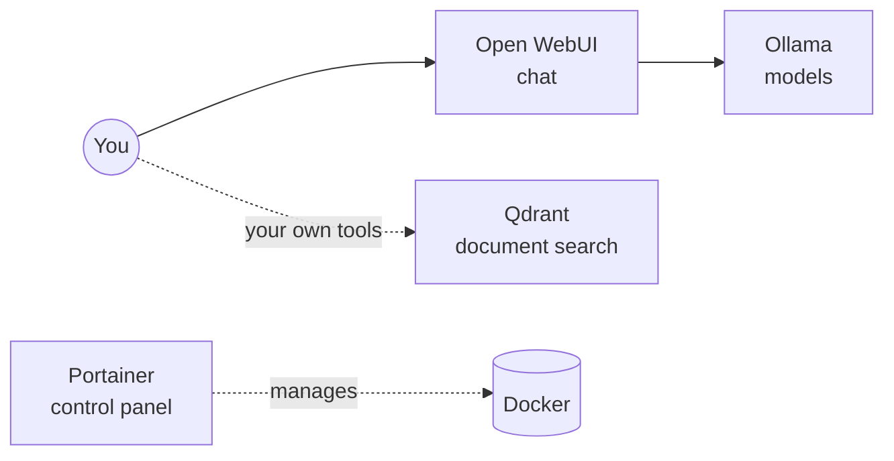

# Home AI lab

A private, ChatGPT-style assistant that runs on your own computer, with two optional extras: a search index for your documents and a control panel. Nothing you type or upload leaves your machine.

It follows [5 Docker Containers You Need for a Home AI Lab](https://www.kdnuggets.com/5-docker-containers-you-need-for-a-home-ai-lab) (KDnuggets, October 2026) and uses four of its five containers, leaving out n8n, the automation tool. A helper script, `lab.sh`, handles setup and the everyday commands, so you don't need to learn Docker.

## What's in it

| Part | Job | In plain terms | Open it at |
| --- | --- | --- | --- |
| **Ollama** | Serve | The engine. Downloads open models (Qwen, Gemma, Llama and more) and runs them on your computer. | No page of its own |
| **Open WebUI** | Talk | ChatGPT-style chat in your browser. Upload files, build knowledge bases, save prompts. | http://localhost:3000 |
| **Qdrant** | Remember | A search index for your documents (a "vector database") that your own tools and scripts can look things up in. | http://localhost:6333/dashboard |
| **Portainer** | Manage | A control panel to see, restart and clean up the containers without the terminal. | https://localhost:9443 |

You start with just **Ollama + Open WebUI**, which is a complete working chat setup. Add the other two when you need them (see [Grow the lab](#grow-the-lab)).



## Why run AI locally

- **Private.** Prompts, files and answers stay on your computer, so you can work with call transcripts, customer data or unreleased plans.
- **Free to run.** No per-message bill and no rate limits, so use it as much as you like.
- **The trade-off.** Local models are smaller than Claude or GPT. They're good at summarizing, classifying, extracting and first drafts, and weaker at nuanced writing and multi-step reasoning. Speed depends on your machine.

## What you need

- **A Mac with Apple Silicon (M1 or newer) and 16 GB of memory or more** is the sweet spot. 8 GB works with small models. Windows and Linux work too ([see below](#windows-and-linux)).
- **About 25 GB of free disk**: roughly 6 GB for the containers (14 GB on Windows and Linux, where Ollama runs in Docker too), plus 3 to 20 GB per model.
- **[Docker Desktop](https://www.docker.com/products/docker-desktop/)**, which runs the containers.
- **[The Ollama Mac app](https://ollama.com/download)** (Mac only). On a Mac, Ollama runs as a normal app instead of in Docker, because only the app can use the Mac's GPU. That makes replies several times faster.

## Set it up (Mac, about 20 minutes)

1. **Install Docker Desktop** and open it. Wait until it says the engine is running.
2. **Install the Ollama app** and open it once. A llama icon appears in the menu bar.
3. **Get this folder.** In Terminal:
   ```sh
   git clone https://github.com/ozzyh420/ozzyh420.git
   cd ozzyh420/home-ai-lab
   ```
4. **Run setup** and answer **Y** when it asks about the Ollama Mac app:
   ```sh
   ./lab.sh setup
   ```
   This creates a private `.env` file with your settings and a generated key.
5. **Start the lab.** The first start downloads about 2 GB, so give it a few minutes:
   ```sh
   ./lab.sh start
   ```
6. **Download a model.** Setup suggests one for your computer's memory; see the [model guide](#which-model-to-pull) for others:
   ```sh
   ./lab.sh pull qwen3.5:4b
   ```
7. **Open http://localhost:3000** and create your account. The first account becomes the admin, and it only exists on your computer. Pick the model at the top left and start chatting.

That's a working lab. Close the terminal whenever you like: the lab keeps running in the background and comes back by itself after a restart, as long as Docker Desktop (and on a Mac, the Ollama app) opens at login. Both have a setting for that.

### Windows and Linux

- **Windows:** install Docker Desktop with the WSL 2 option, then run the commands above in an Ubuntu (WSL) terminal. Ollama runs inside Docker.
- **Linux:** install Docker Engine with the Compose plugin.
- **NVIDIA GPU:** setup finds it and turns it on for Ollama. You need the NVIDIA driver, and on Linux also the [NVIDIA Container Toolkit](https://docs.nvidia.com/datacenter/cloud-native/container-toolkit/latest/install-guide.html). AMD GPUs on Linux are picked up too (ROCm).
- **No GPU:** everything works on the CPU, just slower. Stick to the smaller models.

## Which model to pull

| Your computer's memory | Start with | Download | Notes |
| --- | --- | --- | --- |
| Under 12 GB | `qwen3.5:2b` | about 3 GB | Quick summaries, tagging, simple drafts |
| 12 to 23 GB | `qwen3.5:4b` | about 4 GB | Good everyday model. Try `qwen3.5:9b` if answers feel thin |
| 24 to 35 GB | `qwen3.5:9b` | 7 to 9 GB | Noticeably better writing and reasoning |
| 36 GB or more | `gemma4:26b` | 16 to 19 GB | Closest to the cloud models, and quick because it only uses part of itself per word |

Sizes are from [ollama.com](https://ollama.com/library) in October 2026. The rule of thumb is a download no bigger than about half your memory. You can have several models and switch between them in the chat. Run `./lab.sh models` to see what you have; models are also manageable from Open WebUI's admin settings.

## Grow the lab

Each of these is one command. Your choices are saved in `.env`, so `./lab.sh start` brings back exactly what you've turned on.

**`./lab.sh add qdrant`** when you or a developer want to build your own document-search tools on top of your files. If you only want to chat with documents, you don't need it: Open WebUI has document search built in (Workspace, then Knowledge).

**`./lab.sh add portainer`** once you lose track of what's running. The command prints a one-time **setup token**. Open https://localhost:9443 **within 5 minutes**, paste the token, and create the admin user. Your browser will warn about the certificate; that's expected for a local tool, so continue. Then choose **Get Started** to manage this computer's Docker. Missed the window? `./lab.sh restart portainer` gives you a fresh one.

Turn any of them off with `./lab.sh remove <part>`. Its data is kept for when you add it back.

## Everyday commands

| Command | What it does |
| --- | --- |
| `./lab.sh start` | Start the lab and print its addresses |
| `./lab.sh stop` | Stop everything. Your data stays |
| `./lab.sh status` | What's running, where to open it, which models you have |
| `./lab.sh pull <model>` | Download a model |
| `./lab.sh models` | List your models |
| `./lab.sh add <part>` / `remove <part>` | Turn qdrant or portainer on or off |
| `./lab.sh restart [part]` | Restart everything, or one part |
| `./lab.sh logs [part]` | Watch the logs (Ctrl+C to stop watching) |
| `./lab.sh backup` | Save chats, settings and your key to `backups/` |
| `./lab.sh restore backups/<folder>` | Put a backup back |
| `./lab.sh update` | Back up, then move to the versions in `docker-compose.yml` |
| `./lab.sh setup` | Change setup choices. Safe to run again; it keeps your key |

## Keeping it safe

The article lists the first thing that goes wrong with each container. This setup handles each one for you:

- **Your data survives updates.** Models, chats and settings live in Docker volumes, not inside the containers, so restarts, updates and rebuilds don't touch them. The one command that does delete them is `docker compose down -v`, so don't run it.
- **One key, set once.** `.env` holds a key that signs Open WebUI logins. Setup generates it; never change it, or everyone gets logged out. `.env` is excluded from git, and `./lab.sh backup` saves a copy with each backup.
- **Only your computer can reach the lab.** Every port listens on `127.0.0.1`. To use it from your phone on home Wi-Fi, set `LAB_BIND_ADDRESS=0.0.0.0` in `.env` and run `./lab.sh start`. Do that only on a network you trust (Qdrant has no password), and never forward these ports to the internet.
- **Portainer controls all of Docker.** That's what makes it useful, and why it must stay private. The setup token stops anyone else from claiming it first.
- **Back up before experiments.** `./lab.sh backup` pauses the lab for a few seconds and saves everything except models (those can always be downloaded again). Backups contain your chats and key, so keep them private.
- **Less phoning home.** Qdrant's telemetry is switched off, and Open WebUI ships with telemetry off. Portainer asks during setup whether to share anonymous statistics.

## Updating

Versions are pinned so nothing changes until you decide. The current pins, set in `docker-compose.yml`:

| Part | Version | Release notes |
| --- | --- | --- |
| Ollama | 0.40.13 | [github.com/ollama/ollama/releases](https://github.com/ollama/ollama/releases) |
| Open WebUI | v0.12.5 | [github.com/open-webui/open-webui/releases](https://github.com/open-webui/open-webui/releases) |
| Qdrant | v1.20.0 | [github.com/qdrant/qdrant/releases](https://github.com/qdrant/qdrant/releases) |
| Portainer CE | 2.45.3 | [github.com/portainer/portainer/releases](https://github.com/portainer/portainer/releases) |

To update, change the number after `:-` on that part's `image:` line in `docker-compose.yml`, then run `./lab.sh update`. It backs up first, so if the new version misbehaves, put the old number back and run `./lab.sh restore backups/<folder>`. The Ollama Mac app updates itself.

## Troubleshooting

| Problem | Fix |
| --- | --- |
| `permission denied: ./lab.sh` | Run `chmod +x lab.sh` once (common after downloading a ZIP) |
| "Docker isn't running" | Open Docker Desktop and wait for it to finish starting |
| No models in the chat's model picker | Run `./lab.sh pull qwen3.5:4b`. On a Mac, check the Ollama app is running (llama icon in the menu bar) |
| Replies are very slow | Use a smaller model. On a Mac, make sure you chose the Ollama app during setup (run `./lab.sh setup` to switch), and close heavy apps |
| "port is already allocated" | Another app uses that port. Quit it, or change the first number in that part's `ports:` line in `docker-compose.yml` |
| Portainer says it timed out | `./lab.sh restart portainer`, then create the admin within 5 minutes using the new token it prints |
| Something else | `./lab.sh status`, then `./lab.sh logs <part>` shows what that part is saying |

## Files in this folder

| File | What it is |
| --- | --- |
| `lab.sh` | The helper script behind every command above |
| `docker-compose.yml` | The four containers and their settings |
| `compose.native-ollama.yml` | Mac mode: lets Open WebUI reach the Ollama Mac app |
| `compose.nvidia.yml`, `compose.amd.yml` | GPU support for Ollama in Docker |
| `.env.example` | Template for your private `.env` (setup fills it in) |
